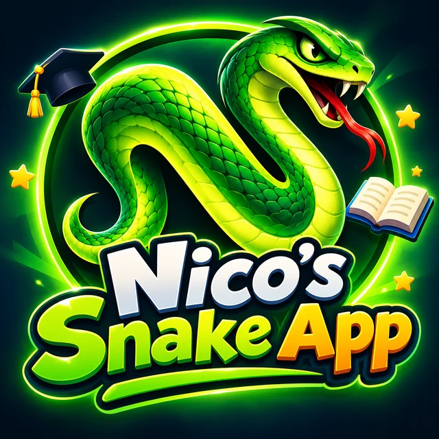

# Nico – visueller Stufenvergleich

> **Status:** Sichtprüfung der produktiven Standardbilder und der vorhandenen Teenager-Ausdrucksvarianten abgeschlossen. Noch keine finale Charakterfreigabe.
> **Branch:** `design/luminous-fantasy-adventure`
> **Grundlage:** [PHASE2_NICO_REFERENZ.md](./PHASE2_NICO_REFERENZ.md) · [DESIGN_SYSTEM.md](./DESIGN_SYSTEM.md)

## 1. Vergleich der fünf Standardstufen

Die folgenden Bilder sind die aktuell in der App verwendeten Standardreferenzen. Das Logo ist zusätzlich als Identitätsreferenz für die höchste Stufe aufgenommen.

### Logo – Identität der erwachsenen/legendären Form

Quelle: `public/images/logo.webp` – Original unverändert lassen.

### Baby

Quelle: `public/images/snake/app/baby-standard.webp`

### Kleinkind

Quelle: `public/images/snake/app/smallChild-standard.webp`

### Kind

Quelle: `public/images/snake/app/child-standard.webp`

### Teenager

Quelle: `public/images/snake/app/teen-standard.webp`

### Erwachsen – derzeitiges App-Bild

Quelle: `public/images/snake/app/adult-standard.webp`

## 2. Ergebnis des direkten Vergleichs

### Baby → Kleinkind: gelungen

- Gleiche grüne Grundfarbwelt, große grüne Augen, helle Schnauze und Schuppenstruktur.
- Der Kopf wird etwas kleiner, der Hals länger und die Körperform eigenständiger.
- Der Übergang wirkt wie natürliches Wachstum derselben Figur.

**Entscheidung:** Beide Standardbilder als Arbeitsreferenzen behalten.

### Kleinkind → Kind: sichtbarster Bruch im frühen Entwicklungsbogen

- Die Augen wechseln von kräftigem Grün zu Bernstein.
- Die Augenpartie wird stärker eingefasst und wirkt deutlich erwachsener.
- Der Kopf bekommt eine andere, breitere und stärker reptilienartige Form.
- Der längere Hals ist als Entwicklung sinnvoll; die Gesichtsänderung wirkt dagegen nicht ausreichend vorbereitet.

**Entscheidung:** Das Kind-Bild nicht verwerfen. Bei einer Überarbeitung zuerst Augenfarbe/Iris und Augenpartie an die jüngeren Stufen annähern. Die gestreckte Körperform und der lebendige Ausdruck können erhalten bleiben.

### Kind → Teenager: Körperentwicklung überzeugend, Gesicht weiter prüfen

- Der Hals wird deutlich länger, der Körper schlanker und die Pose dynamischer.
- Die grüne Augenfarbe kehrt zurück; dadurch wirkt die Identität wieder näher an den jüngeren Stufen.
- Kopf und Augenpartie sind weiterhin etwas stärker stilisiert und markanter als beim Kleinkind.

**Entscheidung:** Teenager-Standardbild als Arbeitsreferenz behalten. Bei der finalen Serie Augenform und Schnauze über Kind und Teenager hinweg auf eine gemeinsame Grundform abstimmen.

### Teenager → Erwachsen: stärkster offener Übergang

- Das Erwachsenenbild hat eine reife, elegante Körperform und eine passende grün-gelbe Schuppenwelt.
- Gegenüber dem Logo ist der Kopf jedoch deutlich schmaler und freundlicher; die Augen, Stirn-/Brauenform und Schnauze weichen ab.
- Das Logo zeigt die ikonische, markante erwachsene Identität: kräftigere Kopfform, prägnante Augenpartie, stärker definierte Schnauze und charakteristische selbstbewusste Mimik.

**Entscheidung:** Das bestehende Erwachsenenbild ist keine finale kanonische Referenz. Das Logo bleibt unverändert und gibt Kopf-, Augen-, Schnauzen- und Schuppenidentität vor. Für die App wird später eine eigenständige, freundliche Begleiterpose aus dieser Identität abgeleitet – ohne Logo-Schriftzug, Doktorhut, Sterne oder andere fest ins Logo integrierte Elemente einfach zu kopieren.

## 3. Teenager-Ausdrucksvarianten – Sichtprüfung

Die vier Dateien wurden einzeln geprüft:

| Datei | Sichtbarer Inhalt | Bewertung |
|---|---|---|
| `teen-happy.webp` | Geschlossene Augen, Lächeln, Herzen und Sterne | Dekoration ist ins Bild eingebrannt; nicht als neutrales Gesichtsasset aktivieren. |
| `teen-tired.webp` | Müder Blick und „Zzz“-Symbole | Ausdruck brauchbar, aber „Zzz“ ist eingebrannt. |
| `teen-eating.webp` | Gefüllte Backen und Maus im Maul | Motiv ist eine vollständige Aktion, kein neutraler Gesichtsausdruck. |
| `teen-surprised.webp` | Große Augen und offener Mund | Am ehesten als eigenständige Reaktion nutzbar; Augenfarbe weicht vom Teenager-Standard ab. |

**Entscheidung:** Die Dateien bleiben unangetastete historische/optionale Varianten. Sie werden vorerst nicht in der Laufzeit aktiviert. Bei Bedarf später saubere Ausdrucksvarianten ohne eingebrannte Herzen, Sterne, Schriftzeichen oder Futterobjekte produzieren.

## 4. Verbindliche Gestaltungsrichtung für die nächste Charakteriteration

1. Baby und Kleinkind bleiben die stilistische Basis für Nicos freundliche Gesichtszüge.
2. Kind und Teenager behalten ihre nachvollziehbare Streckung und Reifung; Augenform, Iris und Schnauze werden über die Stufen hinweg harmonisiert.
3. Die erwachsene/legendäre Form wird vom Logo abgeleitet. Maßgeblich sind Kopf- und Augenidentität, Schuppenmaterial, grün-gelbe Farbwelt und selbstbewusste Ausstrahlung.
4. Die App-Darstellung bleibt kindgerecht und freundlich. Die imposante Logo-Pose wird nicht eins zu eins in die kleine UI-Figur gezwängt.
5. Keine Dekoration, Texte, Futterobjekte oder Effekte in neutrale Charakter-Standardassets einbrennen.
6. Bestehende Dateien werden nicht überschrieben. Neue Entwürfe werden separat und versioniert abgelegt.

## 5. Was noch nicht freigegeben ist

- Die endgültigen Standardbilder aller fünf Stufen.
- Die konkrete erwachsene App-Pose auf Basis der Logo-Identität.
- Die endgültige Augen-/Irisfarbe und Augenform über alle Stufen.
- Die Aktivierung oder Ablösung vorhandener Ausdrucksvarianten.
- Technische Prüfung von Pixelmaßen, Alpha-Kanal, Randtransparenz und Zielauflösung.

**Nächster Produktionsschritt:** Ein kleines Charakter-Referenzpaket mit harmonisierten fünf Standardstufen vorbereiten. Dabei zunächst nur die visuellen Entwürfe erstellen und vergleichen; erst nach ausdrücklicher Freigabe Assets integrieren.
