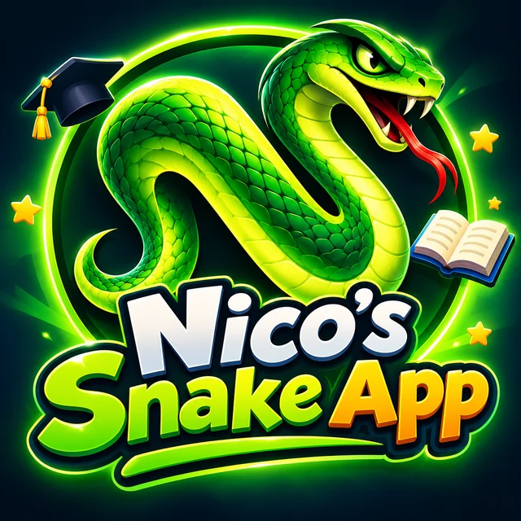
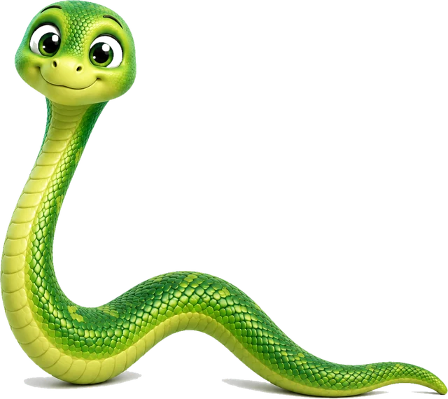
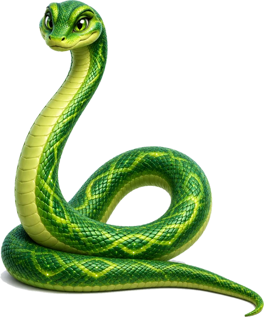

# Nico – kanonische Charakterreferenz

> **Status:** Zweite neutrale Nico-Konzeptiteration vom Projektinhaber freigegeben (26.11.2026); finale Freigabe der fünf separaten Produktionsbilder weiterhin offen.
> **Gültig für:** Phase 2 · Luminous Fantasy Adventure
> **Verbindliche Leitdokumente:** [DESIGN_SYSTEM.md](./DESIGN_SYSTEM.md) · [PHASE2_ASSETPLAN.md](./PHASE2_ASSETPLAN.md) · [PHASE2_ASSETKATALOG.md](./PHASE2_ASSETKATALOG.md)

## 1. Zweck und Grundsatz

Dieses Dokument legt fest, welche vorhandenen Nico-Dateien bis zur visuellen Freigabe als Arbeitsreferenz dienen und welche Lücken vor einer Asset-Serie zu schließen sind. Es führt keine neue Charakteridentität ein.

Nico muss in allen fünf Stufen als dieselbe Schlange erkennbar bleiben. Die Entwicklung erfolgt über Körperproportionen, Haltung, Gesichtsreife, Details und Lichtwirkung – nicht durch einen Wechsel von Art Style oder Spezies.

**Wichtig:** Das vorhandene Logo unter `public/images/logo.webp` ist das unveränderte Key Visual der erwachsenen/legendären Form. Es hat bei der Gestaltung der höchsten Stufe Vorrang vor dem derzeitigen App-Erwachsenenbild.

## 2. Kanonische Arbeitsreferenzen

Bis zur Freigabe gelten folgende Dateien als bevorzugte Bestandsreferenzen:

| Stufe | Kanonische Arbeitsreferenz | Status | Begründung / offene Prüfung |
|---|---|---|---|
| Baby | `public/images/snake/app/baby-standard.webp` | Beibehalten | Stimmiger Ausgangspunkt: kompakt, rund, neugierig und mit klarer Baby-Anmutung. |
| Kleinkind | `public/images/snake/app/smallChild-standard.webp` | Beibehalten | Verständliche Weiterentwicklung mit etwas längerem Hals und weniger übergroßem Kopf. |
| Kind | `public/images/snake/app/child-standard.webp` | Vorläufig beibehalten | Grundform passt; Augenfarbe und Gesichtsform im Übergang zu den jüngeren Stufen prüfen und gegebenenfalls angleichen. |
| Teenager | `public/images/snake/app/teen-standard.webp` | Vorläufig beibehalten | Schlankere, längliche Silhouette vermittelt Reife. Übergang zum Erwachsenen und die vier vorhandenen Zusatzvarianten visuell prüfen. |
| Erwachsen / legendär | `public/images/logo.webp` als Form- und Identitätsreferenz; `public/images/snake/app/adult-standard.webp` nur als Bestandsmaterial | Überarbeiten / abgleichen | Das App-Bild weicht in Kopf, Augen und Silhouette vom Logo ab. Es darf nicht ohne Abgleich als finale höchste Stufe festgeschrieben werden. |

Die Pfade sind Referenzen, keine Aufforderung, Dateien umzubenennen, zu verschieben oder zu löschen. Die historischen Quellenordner bleiben unangetastet.

### Bildreferenzen – aktueller App-Bestand und Logo

Die folgenden Bilder sind Vergleichsreferenzen, keine Freigabe der endgültigen Phase-2-Assets.

**Logo – Identität der erwachsenen/legendären Form**

**Baby**

**Kleinkind**

**Kind**

**Teenager**

**Erwachsen – derzeitiges App-Bild**

## 3. Gemeinsame Identitätsmerkmale

Folgende Merkmale müssen über alle Stufen erkennbar verwandt bleiben:

- **Kopf- und Gesichtsidentität:** ähnliche Grundform von Kopf, Schnauze und Augenposition; altersgerechte Veränderung statt vollständigem Redesign.
- **Augen:** große, ausdrucksstarke Augen als wiederkehrendes Erkennungsmerkmal. Farbton und Irisgestaltung müssen über die Übergänge nachvollziehbar bleiben; der aktuelle Sprung von Grün zu Bernstein zwischen Kleinkind und Kind ist gezielt zu prüfen.
- **Schuppen und Oberfläche:** erkennbare Schuppenstruktur, plastische 3D-Materialität und eine gemeinsame grün-gelbe Grundfarbwelt.
- **Silhouette:** dieselbe Grundanatomie und Körperlogik. Der Körper wird mit dem Alter länger und schlanker, ohne dass Nico wie eine andere Schlangenart wirkt.
- **Licht:** warme, weiche Grundbeleuchtung. Giftgrünes Leuchten und magische Akzente nehmen mit der Reife zu, bleiben aber kontrolliert.
- **Ausdruck und Charakterbogen:** Die Niedlichkeit ist ein bewusstes Merkmal der frühen Stufen, aber kein Dauerzustand. Nico entwickelt sich sichtbar zu einer imposanten, selbstbewussten und schließlich legendären Schlange. Späte Stufen dürfen gefährlich, wild und majestätisch wirken – als machtvoller Beschützer, nicht als bösartiger Gegner.
- **Anatomie:** Nico bleibt in jeder Stufe eindeutig eine Schlange: langer, zusammenhängender, muskulöser Schlangenkörper ohne Beine, Flossen oder Flügel. Keine fischartigen Flossen und keine drachenartigen Gliedmaßen. Kammartige Schuppen, Hörner/Schuppenfortsätze oder stachelartige Konturen am Kopf/Rücken sind möglich, sofern sie wie Schuppenwachstum wirken und die Schlangen-Anatomie nicht brechen.

## 4. Entwicklungsbogen

1. **Baby – neugieriger Anfang:** sehr kompakte, runde Form; großer Kopf und große Augen; weiche, freundliche Ausstrahlung.
2. **Kleinkind – erste Eigenständigkeit:** etwas längerer Hals und Körper; weiterhin kompakt und verspielt; Gesicht bleibt klar mit dem Baby verwandt.
3. **Kind – aktiver Begleiter:** sichtbar gestrecktere Proportionen; selbstbewusster, lebendiger Ausdruck; Augen- und Gesichtsübergang zu den jüngeren Stufen harmonisieren.
4. **Teenager – schlank und kraftvoll:** deutlich längere, schlankere Silhouette; reifer, aber weiterhin sympathischer Gesichtsausdruck; keine abrupte Veränderung von Kopf oder Farbidentität.
5. **Erwachsen / legendär – die Ikone:** deutlich weniger niedlich, dafür majestätisch und einschüchternd schön. Markanter, breiterer Kopf, ausgeprägte Augen-/Brauenpartie, intensive leuchtende Augen, kräftiger Schlangenkörper, überlappende dunkle Smaragd- und Goldschuppen sowie kontrollierte giftgrüne Magie. Enge Orientierung am Logo. Die Wirkung darf gefährlich und uralt sein, bleibt aber Nicos vertraute Identität.

## 5. Varianten und Laufzeitverhalten

Der aktuelle Code in `src/ui/Snake.tsx` nutzt Gesichtsausdrucksdateien nur für `baby`, `smallChild` und `child`. Für Teenager sind zwar die Dateien `teen-happy.webp`, `teen-tired.webp`, `teen-eating.webp` und `teen-surprised.webp` vorhanden, sie werden aber derzeit nicht aktiviert. Für Erwachsene existiert im App-Ordner nur `adult-standard.webp`.

**Festlegung für diesen Schritt:**
- Laufzeitverhalten nicht ändern.
- Teenager-Zusatzvarianten zunächst als unbestätigte Bestandsvarianten führen; erst nach Sichtprüfung entscheiden, ob sie aktiviert werden.
- Keine fehlenden Erwachsenenvarianten generieren, bevor die erwachsene Grundform am Logo ausgerichtet und freigegeben ist.
- Emoji-Overlays und bestehende Reaktionslogik bleiben außerhalb dieser visuellen Referenz unverändert.

## 6. Ergebnis des direkten Bildvergleichs

Der direkte Vergleich der fünf Standardbilder und des Logos ist in diesem Dokument mit den Bildquellen dokumentiert. Daraus folgen diese verbindlichen Arbeitsentscheidungen:

- Baby und Kleinkind bleiben unverändert die stilistische Basis.
- Beim Kind werden Augenfarbe/Iris und Augenpartie als wichtigste Kontinuitätskorrektur behandelt; Körperstreckung und lebendiger Ausdruck bleiben grundsätzlich erhalten.
- Beim Teenager bleiben Standardpose und schlanke Silhouette erhalten; Augenform und Schnauze werden im Übergang zum Kind geprüft.
- Das bisherige Erwachsenenbild ist keine finale kanonische Referenz. Das Logo definiert die erwachsene Identität. Die App benötigt daraus eine eigenständige, souveräne und kraftvolle Begleiterpose – eindrucksvoll und potenziell gefährlich wirkend, nicht verniedlicht, aber klar als Nicos vertraute Figur erkennbar. Logo-Schriftzug und fest integrierte Logo-Dekoration werden nicht kopiert.
- Die vorhandenen Teenager-Ausdrucksvarianten werden nicht aktiviert: Herzen, Sterne, „Zzz“ und Futterobjekt sind teilweise in die Bilder eingebrannt. Sie bleiben als Bestand unangetastet.

## 7. Priorisierte Korrekturen vor Serienproduktion

| Priorität | Thema | Nächster Schritt |
|---|---|---|
| P0 | Erwachsene Form | Logo und `adult-standard.webp` direkt gegenüberstellen; erwachsene App-Referenz an das Logo angleichen. |
| P1 | Kontinuität Kleinkind → Kind | Augenfarbe, Iris, Kopf-/Schnauzenform und Schuppenmaterial vergleichen; nur notwendige Abweichungen korrigieren. |
| P1 | Kontinuität Teenager → Erwachsen | Silhouette, Kopfgröße, Halslänge und Farb-/Lichtentwicklung gemeinsam prüfen. |
| P1 | Teenager-Ausdrucksvarianten | Alle vier Zusatzvarianten gegen Standardbild und bestehende Reaktionszustände prüfen; Nutzungsentscheidung dokumentieren. |
| P2 | Variantenabdeckung | Erst nach Freigabe der fünf Standardstufen festlegen, welche zusätzlichen Erwachsenen-Ausdrücke wirklich benötigt werden. |

## 8. Produktionsregeln für neue Charakterbilder

- Bestehende freigegebene Bilder und das Logo als Referenzen verwenden; keine unabhängige neue Schlange entwerfen.
- Gleiche Kameraperspektive, vergleichbare Bildgröße und konsistente Lichtführung für alle fünf Standardstufen.
- Charakter vollständig und mit ausreichendem Rand zeigen; keine abgeschnittenen Körperteile, sofern der konkrete Einsatzzweck das nicht ausdrücklich verlangt.
- Freigestellte Charaktere mit sauberem transparentem Hintergrund exportieren.
- Keine UI, Texte, Rahmen, Buttons, Futterobjekte oder dekorativen Szenen in Charakterdateien einbetten.
- Standardpose zuerst freigeben; Ausdrucks- und Aktionsvarianten erst anschließend ableiten.
- Originale und historische Quellen nicht überschreiben. Neue Fassungen versioniert ablegen und im Asset-Katalog mit Format, Maßen, Alpha-Kanal, Dateigröße und Verwendung erfassen.

## 9. Abnahmecheckliste

- [ ] Alle fünf Standardstufen nebeneinander in vergleichbarer Größe und Perspektive geprüft.
- [ ] Erwachsene/legendäre Form mit dem Original-Logo abgeglichen und ausdrücklich freigegeben.
- [ ] Augenfarbe und Gesichtsidentität über Baby, Kleinkind und Kind harmonisiert.
- [ ] Übergang Kind → Teenager → Erwachsen zeigt eine deutliche Entwicklung von niedlich über selbstbewusst zu majestätisch/legendär.
- [ ] Alle Stufen haben korrekte Schlangen-Anatomie: durchgehender Schlangenkörper, keine Beine, Flossen oder Flügel.
- [ ] Material, Schuppen, Licht und Detailgrad entsprechen der freigegebenen 3D-Art-Direction.
- [ ] Transparenz, Zuschnitt, Auflösung und Dateigröße technisch geprüft.
- [ ] Laufzeitvarianten und Code-Zuordnung nach visueller Freigabe bewusst entschieden.

## 10. Zweite visuelle Konzeptiteration – neutrale Entwicklungsstufen

Die zweite Konzeptübersicht setzt das Feedback zur stärkeren Entwicklung um: Die frühen Stufen bleiben niedlich, Teenager und Erwachsen/Legendär werden deutlich schlanker, markanter und weniger kindlich. Die Übersicht zeigt Ganzkörper-Silhouetten und ergänzende Kopfansichten. Sie ist eine Stil- und Proportionsstudie, noch keine finale Assetfreigabe.

**Positiv festgehalten:**
- Der Entwicklungsbogen von rund und niedlich zu elegant, kräftig und majestätisch ist klarer.
- Teenager und Erwachsen/Legendär haben markantere Augen-/Brauenpartien, ausgeprägtere Schuppen und dunklere Smaragd-/Goldkontraste.
- Die Schlangen-Anatomie bleibt durchgehend erhalten: langer, zusammenhängender Körper, keine Beine, Flossen oder Flügel.
- Die Kopfansichten helfen, Nicos Identität über die Stufen hinweg zu vergleichen.

**Vor einer finalen Einzelproduktion noch prüfen:**
- Die erwachsene/legendäre Kopfform noch enger an das Logo angleichen: breitere, ikonischere Stirn-/Augenpartie und klarere Cobra-Anmutung, ohne Drachenanatomie.
- Die erwachsene Silhouette darf noch imposanter und gefährlicher wirken; nicht durch niedliche Augen oder ein zu sanftes Lächeln verharmlosen.
- Den Übergang Kind → Teenager weiter schärfen, damit der Teenager nicht nur eine größere Kind-Version ist.
- Für die späteren Einzelassets keine Beschriftungen, Panels oder Symbolleisten übernehmen; nur den Charakter freigestellt exportieren.

**Produktionsentscheidung:** Diese Übersicht ist die bevorzugte aktuelle Richtung für die fünf neutralen Grundformen. Die finale Freigabe erfolgt anhand von fünf separaten, freigestellten Einzelbildern in vergleichbarer Pose und Größe.

## 11. Nicht Bestandteil dieses Schritts

Keine Änderungen an Lernlogik, Entwicklungsgrenzen, Belohnungen, Shop, Speicherung, Navigation oder Laufzeitreaktionen. Keine Bereinigung historischer Dateien. Keine Serienproduktion weiterer Charakterbilder vor der visuellen Freigabe.

## 12. Verbindliche visuelle Spezifikation – Review 25.11.2026

Dieser Abschnitt fasst die bereits dokumentierten Bildvergleiche, die freigegebene Art Direction und die Produktionsentscheidungen zu einer eindeutigen Arbeitsgrundlage zusammen. Er ersetzt keine Bilddatei und ändert keine Laufzeitzuordnung.

### 12.1 Vergleich der fünf Bestandsstufen

| Stufe | Bewertung des dokumentierten Bestandsvergleichs | Entscheidung für die Produktion |
|---|---|---|
| Baby | Die kompakte, runde Form und die großen Augen vermitteln den gewünschten neugierigen Anfang. | `baby-standard.webp` bleibt die bevorzugte Arbeitsbasis. Nicht ohne konkreten Qualitätsgrund neu erfinden. |
| Kleinkind | Die etwas längere Hals-/Körperform ist eine nachvollziehbare Weiterentwicklung; die Baby-Gesichtsidentität bleibt erkennbar. | `smallChild-standard.webp` bleibt die bevorzugte Arbeitsbasis. |
| Kind | Die gestrecktere, aktivere Form funktioniert als nächster Entwicklungsschritt. Der dokumentierte Wechsel von grüner zu bernsteinfarbener Iris und die Augen-/Schnauzenpartie erzeugen jedoch einen Kontinuitätssprung. | `child-standard.webp` bleibt vorläufige Basis. Augen-/Irisfamilie und Kopf-/Schnauzenkontur müssen vor der Freigabe harmonisiert werden. |
| Teenager | Die schlankere, längere Silhouette vermittelt Reife. Der Abstand zur Kind-Stufe und der Übergang zur erwachsenen Logo-Identität sind noch nicht ausreichend abgesichert. | `teen-standard.webp` bleibt vorläufige Basis. Altersproportionen und Augen-/Schnauzenfamilie gezielt prüfen. Die eingebetteten Ausdrucks-/Aktionsvarianten sind keine Produktionsvorlagen. |
| Erwachsen / legendär | Das vorhandene App-Standardbild weicht laut dokumentiertem Vergleich in Kopf, Augen und Silhouette vom Original-Logo ab. | `adult-standard.webp` ist nicht freigegeben. Das unveränderte Logo ist die maßgebliche Identitätsreferenz; daraus wird eine eigenständige App-Begleiterpose entwickelt. |

**Wichtig zur Beleglage:** Die obigen Einzelbefunde übernehmen den im bisherigen Referenzdokument festgehaltenen direkten Bildvergleich. In dieser Dokumentationsrevision konnten die binären Repository-Bilddateien nicht erneut als Bildmaterial geöffnet und unabhängig visuell geprüft werden. Es wird deshalb keine neue Sichtprüfung behauptet. Die finale Einzelbildfreigabe bleibt ein eigener Schritt.

### 12.2 Verbindlicher Entwicklungsbogen

| Stufe | Muss visuell sofort erkennbar sein | Darf sich entwickeln | Darf nicht passieren |
|---|---|---|---|
| Baby | klein, rund, kompakt, großer Kopf und große Augen; offen und staunend | weiche Schuppen, kurze Hals-/Körperform | erwachsene, bedrohliche Mimik |
| Kleinkind | klar dieselbe Figur wie Baby, weiterhin kompakt | etwas längerer Hals und Körper, verspieltere Haltung | Wechsel von Augen-/Kopffamilie |
| Kind | sichtbar gestreckter und aktiver; mutig, wissbegierig, stolz | reifere Augenpartie, längerer Körper | bloß eine vergrößerte Babyfigur |
| Teenager | schlank, athletisch, wild und selbstbewusst | markantere Schuppen-/Kammkontur und reifere Gesichtspartie | nur eine größere Kind-Version oder ein anderer Kreaturentyp |
| Erwachsen / legendär | imposant, majestätisch, souverän und gefährlich wirkend; nahe an der Logo-Identität | kräftiger Körper, markanter breiterer Kopf, dunklere Smaragd-/Goldschuppen und kontrollierte giftgrüne Magie | Verniedlichung, bösartiger Gegner-Look oder Drachenanatomie |

### 12.3 Unveränderliche Identitätsregeln

1. Nico ist in jeder Stufe eindeutig eine Schlange mit langem, zusammenhängendem Körper.
2. Keine Beine, Flossen, Flügel oder fischartige Anatomie. Kammartige Konturen dürfen nur als Schuppenfortsätze lesbar sein.
3. Kopf, Schnauze, Augenposition und Irisgestaltung gehören zu einer erkennbaren Familienähnlichkeit. Altersunterschiede sind erlaubt; ein Identitätswechsel nicht.
4. Eine gemeinsame grüne Grundfarbwelt und erkennbare Schuppenmaterialität verbinden alle Stufen.
5. Die Grundbeleuchtung bleibt warm und weich. Biolumineszentes Giftgrün nimmt mit der Reife zu, wird aber nicht zur flächigen Überstrahlung.
6. Die späten Stufen dürfen wild, uralt und einschüchternd schön wirken. Nico bleibt ein souveräner Begleiter auf der Seite des Kindes, kein Monstergegner.
7. Das Logo unter `public/images/logo.webp` bleibt unverändert. Es ist Identitäts- und Formreferenz der höchsten Stufe, keine zu kopierende App-Pose und kein Ersatz für ein separates Charakterasset.

### 12.4 Abgleich mit Konzept A und der Spielwelt

Konzept A ist eine frühe Stilsondierung für leuchtendes Waldterrarium, modulare Pflanzen-/Kristallobjekte und eine Edelstein-/Münzbelohnung. Es ist weder ein freigegebenes Produktionsasset noch eine eigenständige Nico-Referenz.

Für die gemeinsame Bildsprache werden daraus nur die kompatiblen Richtungsmerkmale übernommen: räumliche Tiefe, hochwertige stilisierte 3D-Materialität, warme Lichtführung, gezielte biolumineszente Akzente und modulare Einzelobjekte. Die Formulierung „cute stylized realism“ ist für Teenager und Erwachsen/Legendär ausdrücklich nicht maßgeblich.

Die Welt muss aus Nicos Lebensraum entstehen: moosige Wurzeln, geschützte Höhlen und Nester, Äste, Farne, Wasser, Kristalle, Häutung und passende Futter-/Sammelobjekte. Generische Fantasy-Requisiten mit nachträglich ergänzten Schlangenmotiven reichen nicht aus. Die Lernansicht bleibt hell, ruhig und kontrastreich; die reichhaltigste Inszenierung gehört ins Terrarium.

### 12.5 Regeln für die fünf neutralen Produktionsreferenzen

Die fünf neutralen Grundformen werden zuerst als fünf eigenständige Dateien produziert. Für einen fairen Vergleich gelten:

- vergleichbare Kameraperspektive, Ausrichtung und Bildmaßstäbe; die konkrete Perspektive wird anhand der freigegebenen Bestandsreferenzen festgelegt und nicht aus einer Konzepttafel geraten;
- vollständige, nicht ungewollt abgeschnittene Körperform mit ausreichend transparentem Rand;
- einheitliche Lichtlogik, Materialqualität, Schuppenlesbarkeit und kontrollierte Highlights;
- transparente Einzelassets ohne Schachbrett-Simulation;
- keine Schrift, Alterslabels, Panels, Rahmen, UI, Herzen, Sterne, „Zzz“, Futter oder sonstige eingebrannte Requisiten;
- jede Stufe einzeln und zusätzlich nebeneinander in gleicher Darstellungsgröße prüfen;
- Originale und bisherige Laufzeitdateien nicht überschreiben; neue Kandidaten versioniert ablegen.

Erst nach Freigabe der fünf neutralen Basen werden die sieben Emotionen abgeleitet. Die 35 Emotionsbilder werden nicht unabhängig voneinander neu entworfen.

### 12.6 Creative-Direction-Entscheidung und Freigabestatus

**Freigegeben ist die visuelle Spezifikation und der Entwicklungsbogen** aus diesem Dokument: Luminous Fantasy Adventure, schlangenspezifische Welt, dieselbe Nico-Identität über fünf klar unterscheidbare Altersstufen und eine erwachsene/legendäre Form nahe am unveränderten Logo.

**Nicht als finale Produktionsassets freigegeben sind** die fünf aktuellen App-Standardbilder, die Teenager-Zusatzvarianten, Konzepttafeln oder das bisherige Erwachsenenbild. Baby und Kleinkind sind bevorzugte Arbeitsbasen; Kind und Teenager sind vorläufige Arbeitsbasen; die erwachsene App-Pose muss neu am Logo ausgerichtet werden.

**Nächster Produktions-Gate:** Fünf neutrale Einzelreferenzen als zusammenhängende Charakterfamilie. Erst wenn die Bilddateien selbst gegen die Bestandsreferenzen und das Logo geprüft werden können, ist eine belastbare visuelle Assetfreigabe möglich. Bis dahin werden keine 35 Emotionsvarianten und keine großflächige Weltserie produziert.

## 13. Freigabe der zweiten Nico-Konzeptiteration – 26.11.2026

Der Projektinhaber hat die zweite neutrale Nico-Konzeptiteration ausdrücklich freigegeben. Damit ist diese Konzeptfassung die verbindliche visuelle Richtung für die fünf Entwicklungsstufen.

Die Freigabe gilt für den dargestellten Entwicklungsbogen und die gestalterische Richtung. Sie ist **keine** pauschale Freigabe der bestehenden App-Bilddateien oder eines einzelnen Produktionskandidaten. Vor der Integration müssen die fünf Stufen weiterhin als separate, freigestellte Einzelassets vorliegen und anhand der Produktionsregeln dieses Dokuments geprüft werden. Insbesondere bleiben die Ausrichtung der erwachsenen/legendären Form am unveränderten Logo sowie die technische und visuelle Einzelbildabnahme erforderlich.
